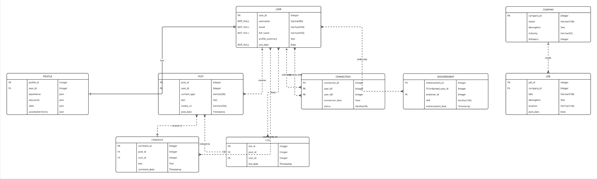

# LinkedIn Product Dissection and Database Design

An AlmaBetter SQL module project. It dissects LinkedIn as a product (the real-world problems it solves and its key features) and designs a relational database schema that could support those features, shown as an ER diagram and as MySQL `CREATE TABLE` statements.

## Contents

| File | What it is |
|---|---|
| [`schema.sql`](schema.sql) | MySQL schema: 9 tables with primary keys, foreign keys and data types |
| [`images/er_diagram.png`](images/er_diagram.png) | ER diagram of the schema |
| [Full write-up (Google Doc)](https://docs.google.com/document/d/1V32MjFzyXRmcB0rAvopLD6v5iVqj90QB51Q3XnwkSWU/edit) | Product dissection, case study and schema explanation |

## Product dissection

LinkedIn (launched 2003, acquired by Microsoft in 2016) is the world's largest professional network, with over a billion members. The dissection looks at four real-world problems and how LinkedIn solves them:

| Problem | LinkedIn's solution |
|---|---|
| Building a professional network beyond local circles | Search by industry or company, "People You May Know" suggestions, connection requests with a note |
| Job search spread across many outdated boards | Central job search with filters, Easy Apply, job alerts, recruiter outreach |
| Proving skills and credibility | Skill endorsements, written recommendations, certifications and projects on the profile |
| Staying current in a fast-changing industry | Curated news feed, hashtags and groups, LinkedIn Learning courses |

Top features covered: user profiles, posts and updates, connections, jobs and career tools, endorsements and recommendations, groups, and Learning.

## Database design

**Entities (9):** Users, Profiles, Posts, Comments, Likes, Connections, Endorsements, Companies, Jobs.

**Relationships:**
- A user **has** one profile (one-to-one).
- A user **creates** many posts (one-to-many).
- Users **comment on** and **like** posts (many-to-many, through `comments` and `likes`).
- Users **connect with** other users (many-to-many, self-referencing through `connections`).
- Users **endorse** skills of other users (many-to-many, self-referencing through `endorsements`).
- A company **posts** many jobs (one-to-many).

**Design choices:**
- Profile details that vary in length (experience, education, skills, accomplishments) are stored as `JSON` instead of separate tables, to keep the profile flexible.
- `connections` stores both user IDs and a `status` (pending or accepted), so one table handles requests and accepted connections.
- `endorsements` references `users` twice: the person endorsed and the endorser.

## Tools

MySQL (schema design), ER diagramming, Google Docs.

## Author

Pranati Pradhan · [GitHub](https://github.com/pranatipradhanwork-alt) · [LinkedIn](https://www.linkedin.com/in/pranati-pradhan)
